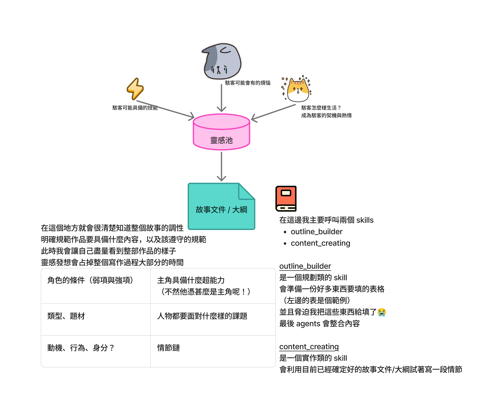
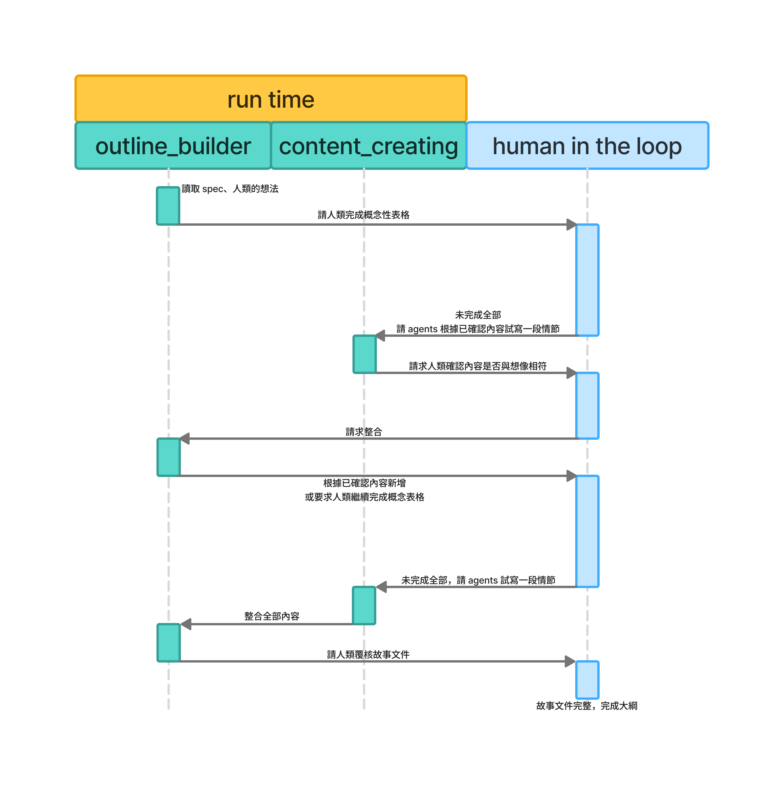
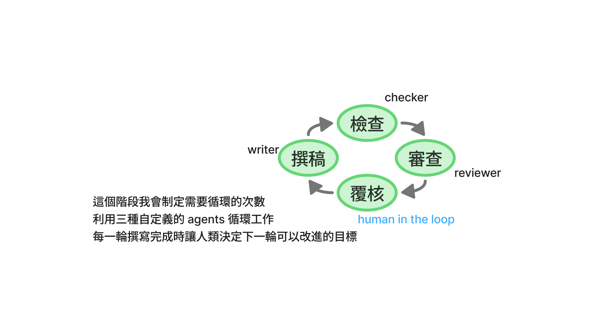
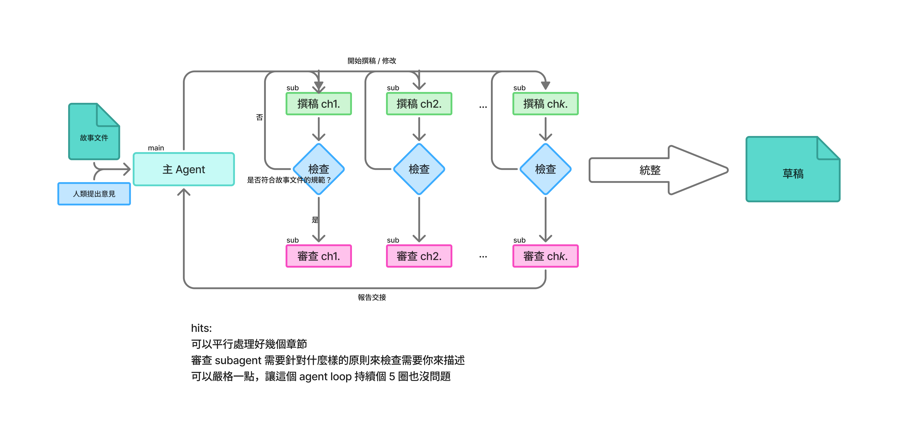

# daihon-writing

一套協助作者產出草稿的協作寫作流程。整理寫作時的分工與檢查方式；草稿完成後，仍由作者決定如何修改並完成作品。

## 架構

流程由三部分組成：人類制定標準文件、建立具體的故事文件與大綱，再依據這些文件撰寫草稿。

草稿階段由主 agent 安排三種工作：`writer` 依故事文件與指示撰稿；`checker` 對照故事文件及明確規範，檢查內容是否符合要求；`reviewer` 檢視台詞、上下文與可聽性，提出修正方向。主 agent 彙整結果，交由人類覆核並決定下一輪要改什麼。

## 大綱撰寫

## 草稿撰寫

## 目錄指引

| 目錄 | 用途 |
| --- | --- |
| `.agents/agents/` | writer、checker、reviewer 的角色與職責。 |
| `.agents/skills/` | 故事文件、草稿撰寫、派工與交接流程。 |
| `specs/standards/` | 草稿審查標準與報告格式。 |
| `specs/writing/` | 劇本寫作指引與寫作名詞定義。 |
